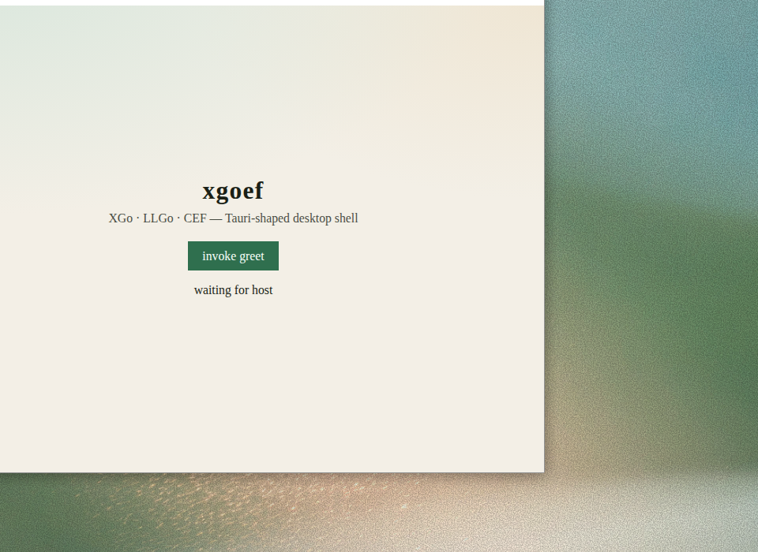
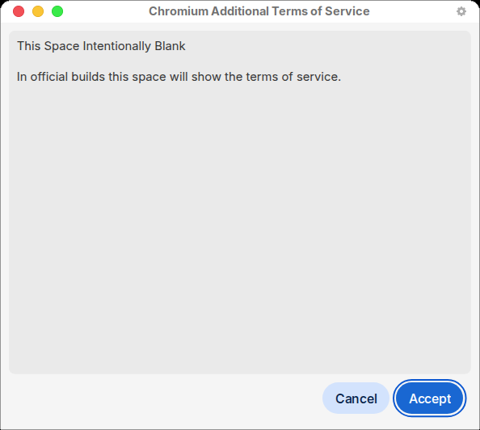
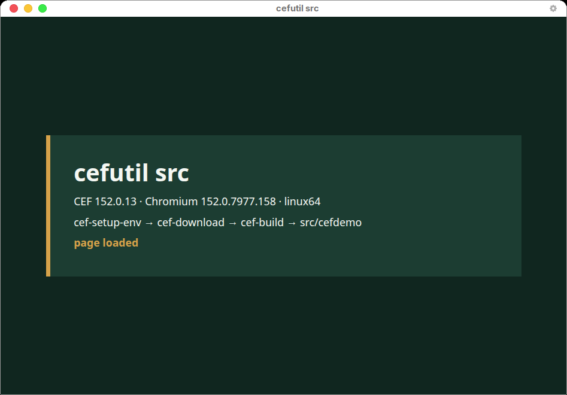
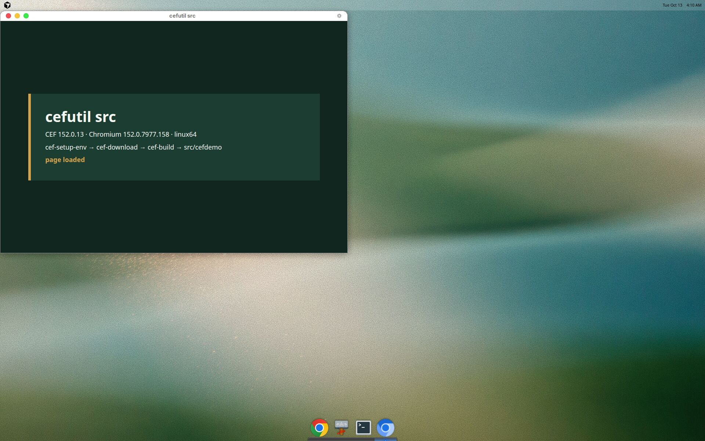

# CEF 文档与技能

官方接口说明在 <https://chromiumembedded.github.io/cef/>。源码在 <https://github.com/chromiumembedded/cef>。预编译包在 <https://cef-builds.spotifycdn.com/index.html>。二次开发的起点是 <https://github.com/chromiumembedded/cef-project>。

文档和技能的核对日期是 **2026-10-13**。支持中的分支以 [Branches and Building](https://chromiumembedded.github.io/cef/branches_and_building.html) 为准。

## 有用的文档

`docs/` 说明现行 CEF 的结构，供人阅读，也供技能在动手前查阅。从 [文档地图](docs/README.md) 进入。

| 文档 | 内容 |
| --- | --- |
| [位置](docs/01-place.md) | 什么产品该用 CEF |
| [架构](docs/02-architecture.md) | Chrome bootstrap、Chrome style、Alloy style |
| [二进制边界](docs/03-binary-boundary.md) | C API、wrapper、`CEF_API_VERSION` |
| [进程和线程](docs/04-processes-and-threads.md) | 代码写在哪个进程 |
| [启动与关闭](docs/05-lifecycle.md) | 入口、消息循环、两段式关闭 |
| [应用怎么拆](docs/06-application-shape.md) | `CefApp`、`CefClient`、`CefBrowser` |
| [JavaScript](docs/07-javascript.md) | 消息路由 |
| [页面放在哪里](docs/08-hosting.md) | Views、原生父窗口、离屏渲染 |
| [集成顺序](docs/09-integrate.md) | 嵌进已有程序的检查表 |
| [发布与升级](docs/10-ship-and-upgrade.md) | 分支、沙箱、换包 |

## 技能

`skills/` 是给 coding agent 的操作技能。代理按这个顺序执行，不从归档文档里推断命令。

| 顺序 | 技能 | 作用 |
| --- | --- | --- |
| 1 | [cef-setup-env](skills/cef-setup-env/SKILL.md) | 配置 CMake 和编译器 |
| 2 | [cef-download](skills/cef-download/SKILL.md) | 下载并校验当前分支的二进制包 |
| 3 | [cef-build](skills/cef-build/SKILL.md) | 编译并运行 `cefsimple` |
| 4 | [cef-create-project](skills/cef-create-project/SKILL.md) | 从 cefsimple 创建二次开发工程 |
| 5 | [cef-integrate](skills/cef-integrate/SKILL.md) | 集成到已经存在的程序 |

安装、本地打包和自动发布见 [skills/README.md](skills/README.md)。`master` 上 `skills/VERSION` 变化后，[Skills release](.github/workflows/skills-release.yml) 会发布 `skills-v<version>`，附件是 `cef-agent-skills-<version>.zip`。

全新程序走到第 4 步。已有程序在第 3 步确认能编过之后，使用第 5 步。

## XGo / CEF 框架实验（xgoef）

`src/xgoef/` 是并行实验：用 [XGo](https://xgo.dev) + [LLGo](https://github.com/xgo-dev/llgo) + [llcppg](https://github.com/goplus/llcppg) 基于 CEF **C API** 做类似 [Tauri 2](https://v2.tauri.app) 的客户端框架。调研与设计见 [src/xgoef/RESEARCH.md](src/xgoef/RESEARCH.md)、[src/xgoef/DESIGN.md](src/xgoef/DESIGN.md)。C++ 基准样例仍是下面的 `cefdemo`。

hello 已能在 Linux 上弹出 CEF 窗口（**XGo** 应用 + **LLGo** + C API shim，无 cgo）：

```bash
./scripts/build-xgoef-hello.sh
cd src/xgoef/build/hello && ./xgoef-hello
```



说明见 [src/xgoef/docs/run.md](src/xgoef/docs/run.md)。

## 用这组技能构建 src

下面是 2026-10-13 在 Ubuntu 24.04 上按技能顺序走完的记录。主机是 gcc/g++ 13.3.0、CMake 3.28.3、Python 3.12.3。`/usr/bin/c++` 实际是 clang 18.1.3。选中的包是 Extended 分支上的标准 linux64 包：

```text
CEF_VERSION=152.0.13+g841e03d+chromium-152.0.7977.158
platform=linux64
SHA1=5dfbd18933fb4bc58eef4058586c03d1a3fa0e6d
```

下载地址是 `https://cef-builds.spotifycdn.com/cef_binary_152.0.13%2Bg841e03d%2Bchromium-152.0.7977.158_linux64.tar.bz2`。解压目录和编译输出在 `third_party/`、`src/build/`，由 `.gitignore` 排除，不进仓库。

### 1. cef-setup-env

编译和开窗口用到：

```bash
sudo apt-get install -y libgtk-3-dev libnss3 libxss1 libasound2t64 libgbm1 \
  libxcomposite1 libxdamage1 libxrandr2 libpango-1.0-0 libcups2 libatk1.0-0 \
  libatk-bridge2.0-0 libxkbcommon0 libdrm2
```

`build-essential` 和 CMake 3.28 已经在这台机器上。默认仓库没有 `python3.11`，cef-project 要求用 3.9–3.11 下载 clang-format，所以这次没有克隆 cef-project。二进制包本身的 CMake 不需要那个 Python。

第一次用默认的 `/usr/bin/c++` 配置时，链接失败：`/usr/bin/ld: cannot find -lstdc++`。clang 18 选了 GCC 14，而 `libstdc++.so` 只在 GCC 13 的目录里。之后的配置都加上 `-DCMAKE_C_COMPILER=gcc -DCMAKE_CXX_COMPILER=g++`。

### 2. cef-download

```bash
VER=152.0.13+g841e03d+chromium-152.0.7977.158
PLAT=linux64
ENC=${VER//+/%2B}
mkdir -p third_party/cef
cd third_party/cef
curl -fsSL -o "cef_binary_${VER}_${PLAT}.tar.bz2.sha1" \
  "https://cef-builds.spotifycdn.com/cef_binary_${ENC}_${PLAT}.tar.bz2.sha1"
curl -fL -o "cef_binary_${VER}_${PLAT}.tar.bz2" \
  "https://cef-builds.spotifycdn.com/cef_binary_${ENC}_${PLAT}.tar.bz2"
echo "5dfbd18933fb4bc58eef4058586c03d1a3fa0e6d  cef_binary_${VER}_${PLAT}.tar.bz2" | sha1sum -c -
tar -xf "cef_binary_${VER}_${PLAT}.tar.bz2"
```

解压后能看到 `CMakeLists.txt`、`include/`、`Release/`、`Resources/`、`libcef_dll/`。`CEF_ROOT` 就是这个解压目录。

### 3. cef-build

```bash
cmake -S "$CEF_ROOT" -B "$CEF_ROOT/build" -G "Unix Makefiles" \
  -DCMAKE_BUILD_TYPE=Release -DUSE_SANDBOX=OFF \
  -DCMAKE_C_COMPILER=gcc -DCMAKE_CXX_COMPILER=g++
cmake --build "$CEF_ROOT/build" --target cefsimple -j"$(nproc)"
```

可执行文件在 `$CEF_ROOT/build/tests/cefsimple/Release/cefsimple`。构建结束时 CMake 会打印一条要对 `chrome-sandbox` 执行的 `sudo chown` / `chmod 4755`。这次沙箱是关的，没有执行那条命令。缺 Doxygen 只产生警告。

在 `DISPLAY=:1` 上运行后，窗口标题是 Google，页面是 Google 首页。点窗口左上角关闭后进程退出。


### 4. 二次开发工程 src/cefdemo

`src/` 是对着已解压二进制包写的独立 CMake 工程：`-DCEF_ROOT`、`find_package(CEF)`、`libcef_dll_wrapper`，再加上 `cefdemo`。入口先跑 `CefExecuteProcess`，学习构建设置 `no_sandbox`，并把 `root_cache_path` 指到输出目录下的 `root_cache/`。页面是 `src/cefdemo/web/index.html`。主框架加载结束后，`OnLoadEnd` 把页面上的 `waiting` 改成 `page loaded`。

```bash
cmake -S src -B src/build -G "Unix Makefiles" \
  -DCMAKE_BUILD_TYPE=Release -DUSE_SANDBOX=OFF \
  -DCMAKE_C_COMPILER=gcc -DCMAKE_CXX_COMPILER=g++ \
  -DCEF_ROOT="$CEF_ROOT"
cmake --build src/build --target cefdemo -j"$(nproc)"
cd src/build/cefdemo/Release
./cefdemo
```

产物是 `src/build/cefdemo/Release/cefdemo`，旁边有 `libcef.so`、pak、`locales/` 和 `web/`。

这个 `root_cache` 是第一次使用，Chrome style 先弹出 “Chromium Additional Terms of Service”。正文写着官方包才会放条款，这里是占位。点 Accept 之后出现标题为 `cefutil src` 的窗口。



页面上能看到版本号、技能顺序，以及由渲染进程改写的 `page loaded`。





点窗口关闭按钮后进程退出，没有残留的 `cefdemo` 子进程。日志里有 dbus 地址无法解析、UPower 服务不存在，窗口仍然显示。关掉的过程中 Chromium 可能打出 `Timeout of new browser info response`，进程随后退出。

## 归档

[archive/](archive/README.md) 只保存旧的 PDF 和 Word。那些文件记录的是早期 GYP 和旧译文，不能用于现在的下载、编译或集成。
